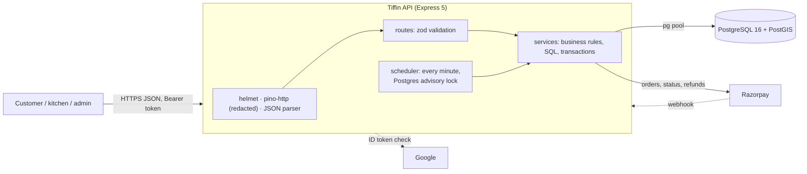
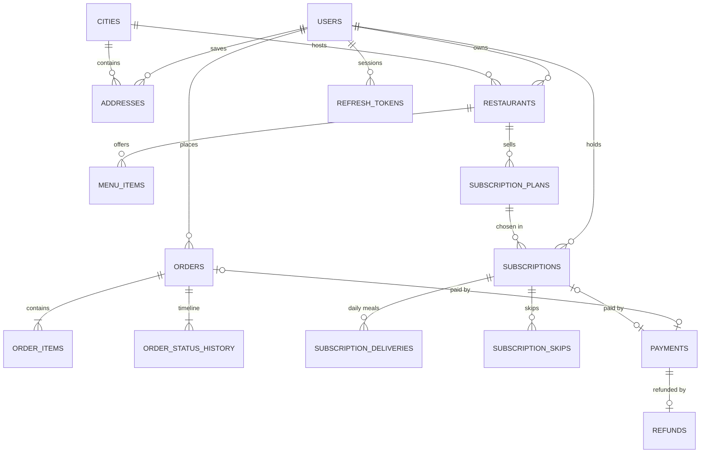

# Tiffin v2

Backend API for a home-food (tiffin) delivery service in India. Customers save addresses anywhere in India, find kitchens that deliver there, order meals or subscribe to daily meal plans, and pay online through Razorpay. Kitchens manage menus, plans, an order inbox and a daily head-count. Cancelled payments are refunded automatically, in full or pro rata.

**Stack:** Node.js 24 · Express 5 · PostgreSQL 16 + PostGIS · raw SQL with `pg` · zod · pino · Jest

This is a rewrite of the [original app](../v1) with a stronger data model, transactions and tests.

---

## Architecture



Routes validate input and shape responses; services hold the business rules and all SQL; the database enforces the invariants that must never break (foreign keys, CHECKs, triggers, partial unique indexes).

## Features

| Area | What it does |
|---|---|
| Accounts | Register and log in with email + password or Google; roles customer, kitchen owner, admin |
| Addresses | Map pins limited to India and to 50 km of their city; one default address per user |
| Discovery | Kitchens whose delivery radius covers a saved address, nearest first |
| Orders | Cart → one order with prices from the database, delivery fee, idempotent retries |
| Order lifecycle | awaiting payment → pending → confirmed → preparing → out for delivery → delivered, with cancellation rules per role and a full status history |
| Subscriptions | Plans of N meals on weekdays the customer picks; skip days or pause ranges (meals are postponed, not lost) |
| Daily deliveries | At 9 PM IST tomorrow's deliveries are created and locked; kitchens see a head-count and mark each meal delivered or missed |
| Payments | Razorpay checkout for orders and subscriptions, signature verification, status reconciliation, webhooks |
| Refunds | Full refunds for cancelled paid orders, pro-rata refunds for cancelled subscriptions, refunds for late payments |

## Engineering notes

**Money is exact.** Amounts are integer paise. `orders.total_paise = subtotal_paise + delivery_fee_paise` is a CHECK constraint, and refunds are rounded down so they can never exceed the payment (a trigger enforces that too).

**Placing an order is one transaction.** The address must belong to the caller, lie inside the kitchen's radius, and every item must be available; prices are read from the database under `FOR SHARE`, so a concurrent price change waits. Items are inserted with one `INSERT … SELECT FROM unnest(…)`.

**Retries never create duplicates.** `POST /orders` requires an `Idempotency-Key`. The order stores the key and a SHA-256 fingerprint of the cart: the same key and cart replays the original response; the same key with a different cart is rejected with 422. Two simultaneous requests with one key are settled by a unique index and `INSERT … ON CONFLICT DO NOTHING`.

**Concurrent status changes have one winner.** Status updates are compare-and-set (`UPDATE … WHERE id = $1 AND status = $2`); the loser gets 409. Allowed transitions are checked in the service and again by a database trigger, and every change writes a history row in the same transaction.

**Spatial search uses the index.** Locations are PostGIS `geography` points with a GiST index. A per-kitchen radius can't use the index directly, so discovery first filters with `ST_DWithin` at the largest allowed radius (15 km, also a CHECK constraint), then applies each kitchen's own radius.

**Authentication.** bcrypt at cost 12. Access tokens are 15-minute HS256 JWTs with issuer and audience pinned; refresh tokens are random, stored only as SHA-256 hashes, rotated on every use, and reusing an old one revokes the whole token family. Google sign-in verifies the ID token and links accounts only on a verified email. Another user's resource returns 404, not 403.

**Scheduled jobs are safe to repeat.** A one-minute scheduler runs inside the API behind `pg_try_advisory_lock`, so only one instance works at a time. Every job is idempotent: the nightly delivery job is a single set-based insert guarded by `UNIQUE (subscription_id, delivery_date)`, and each tick catches up anything missed. Calendar dates are IST `YYYY-MM-DD` strings end to end, never JavaScript `Date`s.

**Payments.**
- The server creates the Razorpay order for the database total; the browser only receives its id.
- The checkout result is verified with HMAC-SHA256 compared in constant time.
- The gateway is never called inside a database transaction. Refunds use an outbox: the refund row is written in the cancelling transaction and a job sends it, first asking the gateway whether a refund tagged with that id already exists, so a crash can't refund twice.
- A reconciliation job asks Razorpay about unpaid orders (the customer may close the tab after paying); unpaid orders expire after 15 minutes.
- The webhook is verified against the raw request body, cross-checked with the gateway before use, and idempotent; handled event ids are recorded after processing, and payloads (which contain customer contact details) are never stored.
- The gateway sits behind an interface with an offline fake, so every payment flow is testable without network or keys; production refuses the fake and development refuses live keys.

**Lists use keyset pagination** on `(created_at, id)` with an opaque cursor that keeps microsecond precision, so pages stay stable while new orders arrive.

**Logs hold no secrets.** JSON logs redact `authorization`, cookies and webhook signatures; request bodies are never logged; third-party error messages are trimmed before logging.

## Data model



Orders carry `city_id` through a composite foreign key with the restaurant, and order items reference `(menu_item_id, restaurant_id)`, so an order can never contain another kitchen's dish. Orders and deliveries copy the address, item names and prices at the time they were created.

## API

All routes are under `/api/v1` and return errors as `{ "error": { "code", "message", "details" } }`.

| Resource | Endpoints |
|---|---|
| Auth | `POST /auth/register`, `/auth/login`, `/auth/google`, `/auth/refresh`, `/auth/logout` · `GET /me` |
| Cities, addresses | `GET/POST /cities` · `GET/POST /addresses`, `GET/PATCH/DELETE /addresses/:id`, `PATCH /addresses/:id/default` |
| Restaurants | `GET/POST /restaurants`, `GET/PATCH /restaurants/:id`, `GET /restaurants/:id/menu`, `POST /restaurants/:id/menu-items`, `PATCH /restaurants/:id/menu-items/:itemId` |
| Kitchen views | `GET /restaurants/:id/orders`, `GET /restaurants/:id/deliveries?date=` |
| Plans | `GET/POST /restaurants/:id/plans`, `PATCH /restaurants/:id/plans/:planId` |
| Orders | `POST /orders` (Idempotency-Key), `GET /orders`, `GET /orders/:id`, `PATCH /orders/:id/status`, `POST /orders/:id/cancel`, `POST /orders/:id/payment`, `POST /orders/:id/payment/verify` |
| Subscriptions | `POST/GET /subscriptions`, `GET /subscriptions/:id`, `POST /subscriptions/:id/cancel`, `POST /subscriptions/:id/skips`, `DELETE /subscriptions/:id/skips/:date`, `POST /subscriptions/:id/payment`, `POST /subscriptions/:id/payment/verify` |
| Deliveries | `PATCH /deliveries/:id/status` |
| Admin | `PATCH /users/:id/role` |
| Webhook | `POST /payments/webhook` (Razorpay, signature-verified) |

## Running locally

Requirements: Node.js 24, PostgreSQL 16 with PostGIS 3.

```bash
cp .env.example .env          # then fill in the values
npm install
npm run migrate               # applies migrations/*.sql in order
npm run seed                  # sample cities, kitchens, menus and users
npm run dev                   # http://localhost:3000/health
```

Payments use an offline fake gateway by default (`PAYMENT_PROVIDER=fake`). To use Razorpay test mode, set `PAYMENT_PROVIDER=razorpay` and the test keys.

Run a scheduled job by hand: `npm run job -- deliveries [--date YYYY-MM-DD]`, `auto-cancel`, `payments` or `refunds`.

## Tests

```bash
npm run test:unit             # pure functions: clock, refunds, signatures, validation
npm test                      # all tests
```

Tests only ever run against a database whose name ends in `_test` (by default `tiffin_test` on the same server); anything else is refused before a connection is made. `scripts/manual-tests/` holds end-to-end scripts that exercise the running API, including concurrency races, tampered tokens and signatures, and direct-SQL attempts to break database constraints.

## Project structure

```text
src/
  app.js, server.js       Express app and process lifecycle
  config.js, logger.js    validated environment, redacted logging
  routes/                 HTTP layer: validation and responses
  services/               business rules and SQL
  payments/               gateway interface: Razorpay client, offline fake, signatures
  jobs/                   scheduler, nightly deliveries, auto-cancel
migrations/               numbered SQL migrations (never edited once applied)
scripts/                  migrate, seed, run a job, end-to-end test scripts
test/                     Jest tests
dev/                      local pages for Google sign-in and Razorpay test checkout
```

## Roadmap

- API tests against a real test database, run in CI (GitHub Actions with PostGIS)
- Docker image and `docker compose` for the API and database
- Rate limiting and a discovery cache (Redis)
- Deployment with backups and a tested restore
